

<h1 align="center">AgentTandem</h1>

Chat with Claude Code and Codex, review saved changes, manage accounts and track tokens — inside VS Code.

Keep working in your native agent or use the built-in chat. AgentTandem brings saved file changes, conversation history, account switching and usage into one workspace companion.

| Feature | What you can do |
| --- | --- |
| Code and image review | Compare saved snapshots, accept or reject individual blocks, navigate files and undo the latest revert. |
| Chat and history | Run Codex or Claude Code, resume project conversations, attach files and queue follow-ups. |
| Account management | Save and switch Codex, Claude Code, Cursor and Antigravity sign-ins. |
| Token dashboard | Explore account, model and conversation totals, cache usage and estimated API costs. |
| Live quota | See remaining allowance, reset times, observed burn rate and quota estimates. |
| Checkpoints and storage | Preview code restores, see what agent history takes up, delete old Codex/Claude conversations and track how much space you have freed. |

## Get started

1. Install **AgentTandem** in VS Code and open your project. For chat, install and sign in to the Codex or Claude Code CLI you want to use.
2. Select **AgentTandem** in the Activity Bar. Check **Tracking on** in the status bar before asking an agent to edit. If tracking is off, click it, choose **Resume tracking** and wait until it is ready.
3. Work in your usual agent tool, or select **+** to start a built-in chat. **Manage CLIs** lets you choose an installed CLI.
4. Save your changes, open **Review** and select a file. **Accept** keeps the code and marks it reviewed; **Reject / Revert** restores the saved baseline. Accept does not create a Git commit.

Tracking captures saved, non-ignored files, including manual edits. It cannot reconstruct changes made before tracking starts. Running agents requires a trusted workspace and an authenticated CLI.

## Review code and images

Review opens with changed files grouped by conversation. Shared and unassigned changes stay visible when their source cannot be established. Select a file to compare immutable before/after snapshots in the bundled Monaco editor, with syntax highlighting, search and inline actions.

- **Accept / Reject** acts on an individual change block. **Accept all** keeps all changes in the current file; **Reject all** restores the whole file to its saved baseline after a confirmation that names the file. Newer saved edits and unsaved buffers still block rejection, and **Undo** recovers it.
- **Previous / Next change** and **Previous / Next file** move through the review. Use the file picker to jump directly to another file.
- File and conversation **Revert** actions preview their scope. **Undo** recovers the latest file, group or block revert.
- **…** contains Refresh, Native diff and conversation details. Images show saved **Before / After** versions with whole-file actions.
- Image changes opened from **Source Control** (and Git image diff tabs restored after a reload) open in AgentTandem's **Before / After** view instead of VS Code's built-in Git image diff, which in VS Code 1.142 fails on its original side (`Cannot read properties of undefined (reading 'selection')`) and closes. Staged changes compare HEAD → index, unstaged index → working tree, with **Previous / Next file** across the changed images. **AgentTandem: Open Image Changes** (Source Control context menu, image editor title, Command Palette) opens it directly; set `agentTandem.openGitImageDiffs` to `false` to keep the built-in diff.

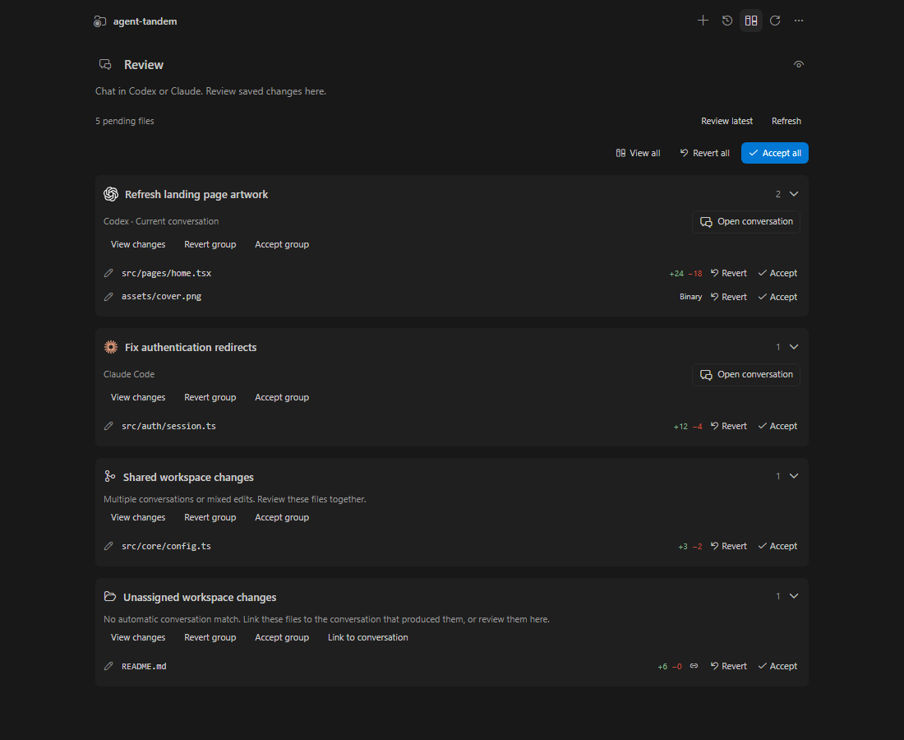

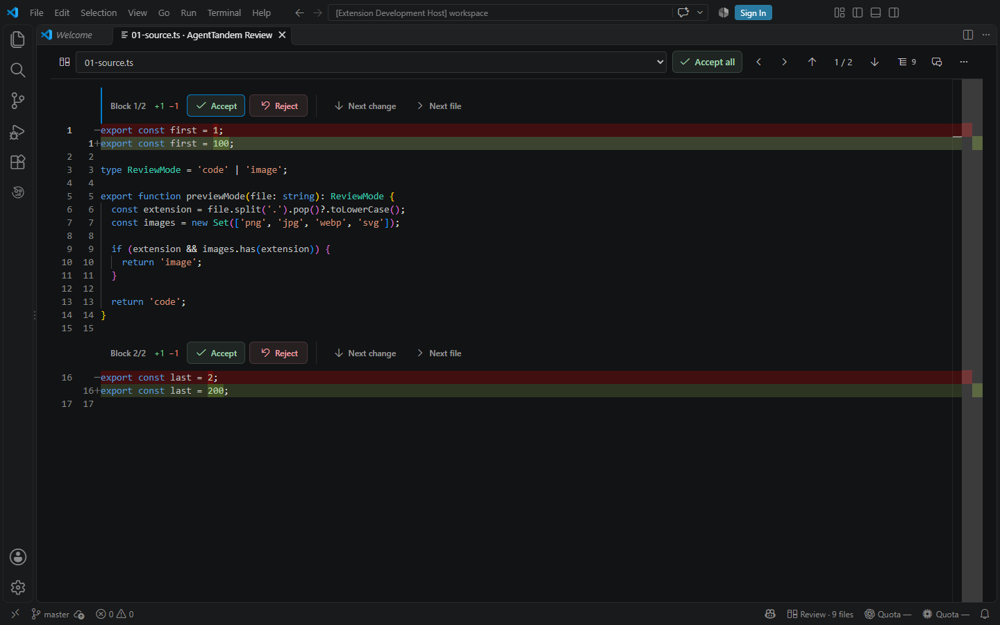

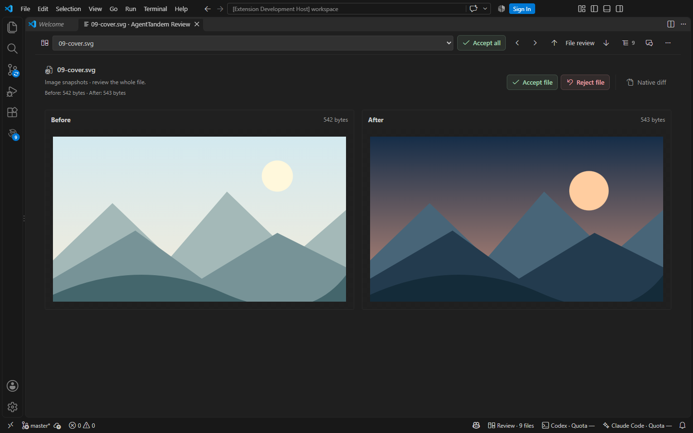

## Manage accounts

Run **AgentTandem: Manage Accounts**, or open **Settings → Accounts**. Filter by app and search saved profiles for **Codex, Claude Code, Cursor and Antigravity**.

1. Select **Add account** and choose an app. For Codex or Claude Code, sign in through the native CLI, **Save current sign-in**, or **Import JSON**. For Cursor or Antigravity, open the installed app, sign in there and save its current sign-in.
2. Select **Switch account** to update the default CLI or IDE sign-in. Finish active agent turns first; close Cursor/Antigravity windows before switching and reopen the app afterward.
3. Follow the progress dialog and timestamped log. **Hide** keeps the operation running; **View switch log** reopens the latest result. The switch saves the outgoing sign-in, verifies the selected identity and attempts rollback if verification fails.

After a Codex or Claude Code switch, select **Restart Extension Host** to let the native VS Code extension pick up the new sign-in, or **Later** to defer it.

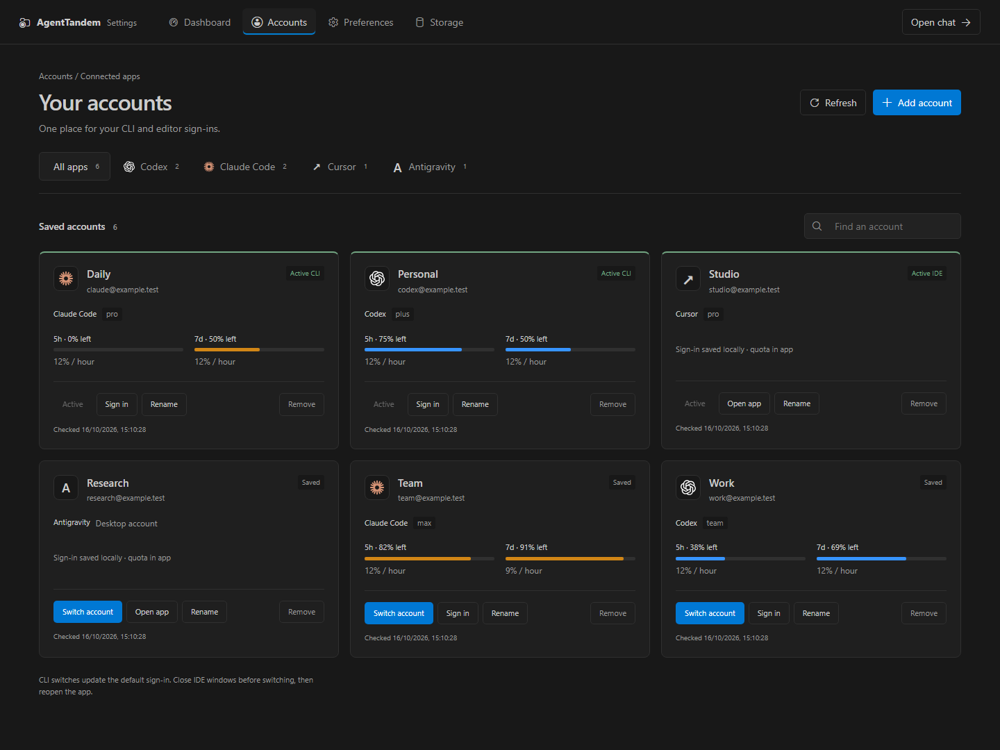

Hover a provider's quota in the VS Code status bar to open the account menu: remaining quota, reset countdowns, saved accounts and **Open dashboard** are available without clicking the status bar. Select a saved account to switch. **Manage accounts** and **Refresh quota** stay in the menu; clicking the status bar opens a searchable account picker with the same labeled shortcuts. In the dashboard, **View usage** selects an account's statistics without switching its sign-in.

Quota rows use theme colors: green for healthy, amber at 25% remaining or less, red when exhausted. The active account, reset actions and extension storage have distinct icons.

The hover and status bar use the same current quota snapshot. Repeated limit windows and saved copies of the same account appear once; hover percentages show quota **remaining**, and saved quota is marked **Cached quota**. A profile named after its email does not repeat that email on the next line.

Saved-account quota is checked in the background at most once every ten minutes, even with Settings closed. Opening the status-bar hover checks the same cache when VS Code enables `statusBarItemTooltip`; other builds use the background snapshot. Manual refresh has a one-minute cooldown. Reads are sequential, overlapping refreshes share one job, and failures back off from ten minutes up to two hours with jitter. A longer `Retry-After` is honored when the CLI exposes it, following [OpenAI's error guidance](https://developers.openai.com/api/docs/guides/error-codes) and [Anthropic's rate-limit guidance](https://platform.claude.com/docs/en/api/rate-limits). These cache intervals are AgentTandem defaults, not provider-published polling limits.

Saved profile identity is checked against credential metadata before native sign-in is mirrored. A different account cannot overwrite a saved profile or supply its plan/quota. Expired sign-ins keep their saved identity and require signing in again.

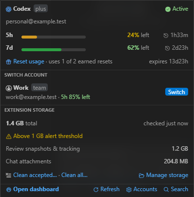

For the active Codex ChatGPT account, **Reset usage** uses **one earned reset** to restore eligible quota. The available count is shown beside the action. After redemption, AgentTandem reads quota from Codex again and reports the result. The action is disabled when no earned resets are available or an agent turn is active; token history stays intact. The same action is available in the account picker and dashboard account cards. Requires a selected Codex CLI that supports earned resets. See [OpenAI Docs: earned rate-limit resets](https://learn.chatgpt.com/docs/app-server#8-earned-rate-limit-resets-chatgpt).

Saved credentials stay in local native-auth profile storage and are not sent to the webview or included in switch logs. Removing a saved profile keeps the default native sign-in and conversation history. Cursor/Antigravity quota stays in the native app; Antigravity 2 OS-vault switching currently supports Windows.

Account switch progress

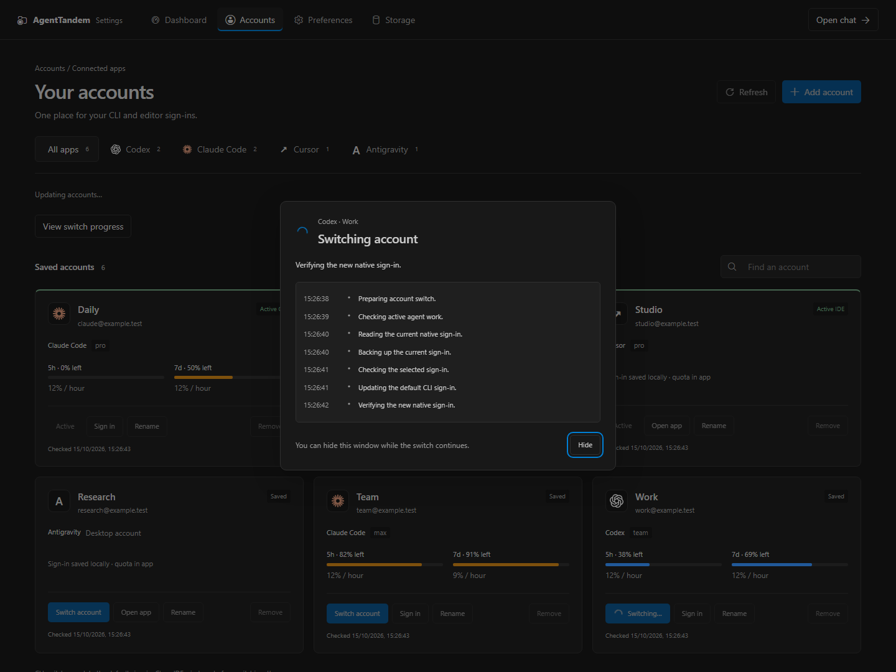

## Token and usage dashboard

Run **AgentTandem: Open Settings and Usage Dashboard**, or use **Dashboard** below chat. The dashboard opens on **By account** and **Today**. Choose **View usage** on an account card, or select **All accounts** for combined local Codex and Claude totals across projects.

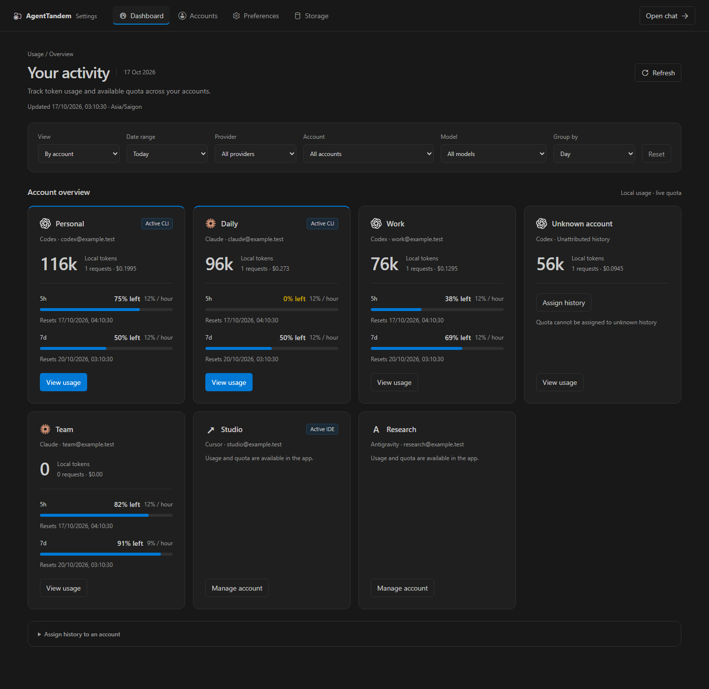

**View usage** opens that account's own dashboard: its API activity, Local totals, cost, chart, quota, burn-down and estimates. Select **← All accounts** to return to the account overview.

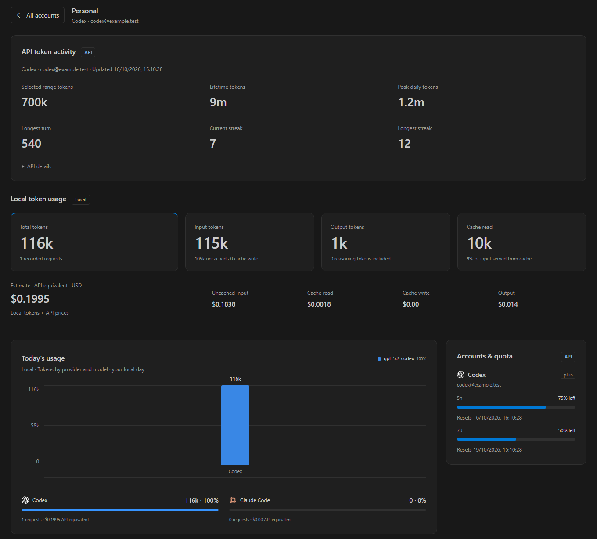

Filter by **provider, account, model and date range**, including custom dates. Group activity by **day, week or month**. Inspect input, output, cache reads/writes, requests, provider/model breakdowns and daily activity.

| Source | What it shows |
| --- | --- |
| **API** | Native account quota and, when supported, Codex account token activity: lifetime tokens, peak day, turn duration, streaks and returned daily totals. |
| **Local** | Deduplicated token counts recorded in local Codex and Claude history across projects, including archived and subagent sessions. |
| **Estimate** | API-equivalent USD cost, tokens per 1% quota and projected reset-cycle capacity. These are estimates, not subscription charges or invoices. |

### Token dashboard

**All accounts** shows API token activity (lifetime tokens, peak day, longest turn and streaks), Local input/output/cache totals, the API-equivalent cost split, token activity stacked by model and current account quota.

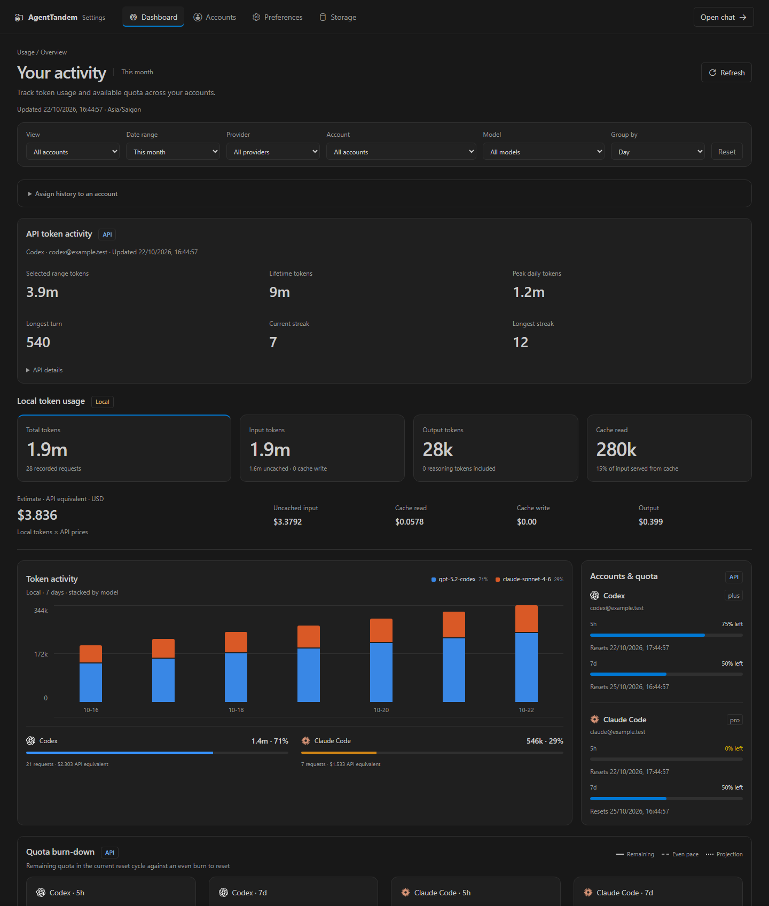

**API activity and Local totals are displayed separately and never added together.** Codex API activity depends on CLI/account support; Claude token details come from local history. Model filters apply to Local usage. Missing API metrics remain unavailable, and unknown model prices remain **Unpriced**.

Account attribution preserves native per-turn evidence. Older Codex history may be labeled **Inferred from session creator**; unmatched history stays **Unknown account**. **Assign history to an account** lets you confirm a conversation/date range or keep it unknown without rewriting native transcripts.

### Quota burn-down

Each quota window (Codex/Claude Code × 5h/7d) gets a card plotting **remaining quota** in the current reset cycle against an **even pace** to reset, plus a **projection** from the recent burn rate. The card says whether the window is **On track** (and how much will be left at reset) or **Runs out ≈ time · before reset**, with even-pace, per-cycle and last-hour rates.

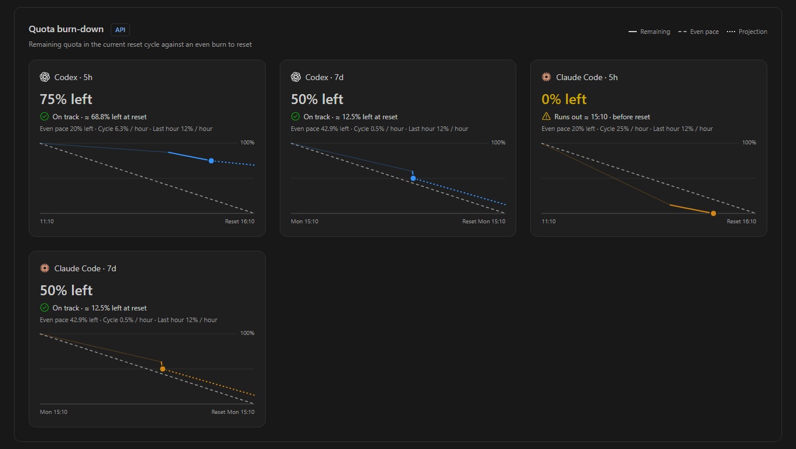

### Tokens per 1% quota

Each provider has separate **5h** and **Weekly** windows. **Estimated full cycle** shows approximately how many tokens a full reset cycle represents: recorded tokens ÷ quota percentage points used × 100. It uses the current cycle's recorded ratio when available, or the weighted average of recorded cycles, with the basis shown below the estimate. Estimated tokens left appear alongside it.

The interval bar shows the quota readings and their recorded tokens, such as **100% → 75% remaining: 804,531 tokens**. Recording that starts partway through a cycle shows that actual interval, such as **84% → 82%**. Older API records without a saved starting reading show **Start unknown**.

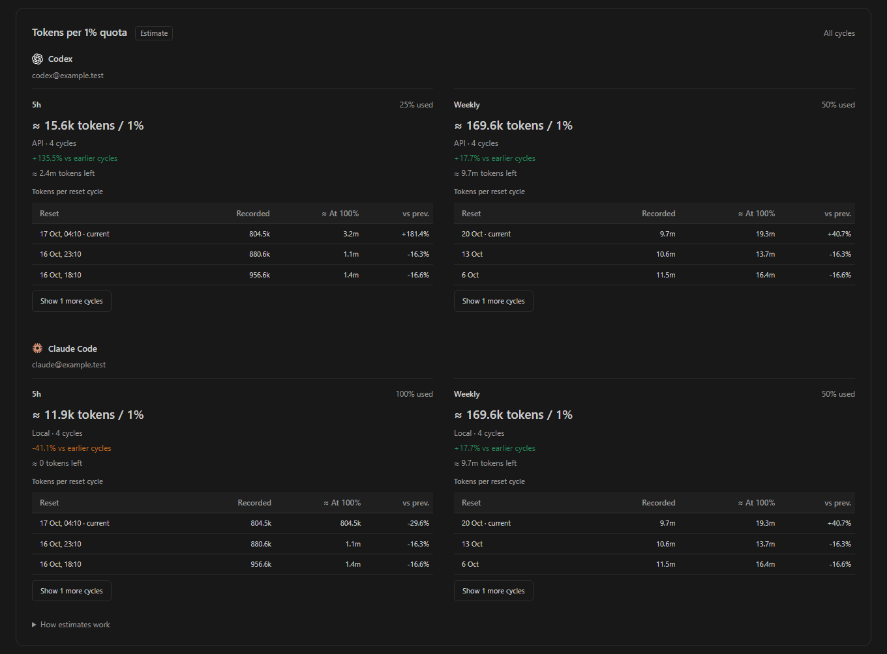

Use **Chart metric** to switch between:

- **Tokens / 1%** — a line chart of cycle ratios, with the weighted average as a dashed line.
- **Recorded tokens** — bars showing the tokens actually recorded in each cycle.
- **Full quota estimate** — bars extrapolating each observed ratio to a full cycle.

Hover or focus a chart point to inspect its reset date, quota interval, recorded tokens and token/1% ratio. Charts show the latest 12 cycles. **Tokens per reset cycle** lists exact recorded counts, quota used, observation times and estimated capacity; **Calculation details** explains the formula. The overall average divides total recorded tokens by total quota percentage points across all recorded cycles.

Recorded tokens and full-cycle estimate charts

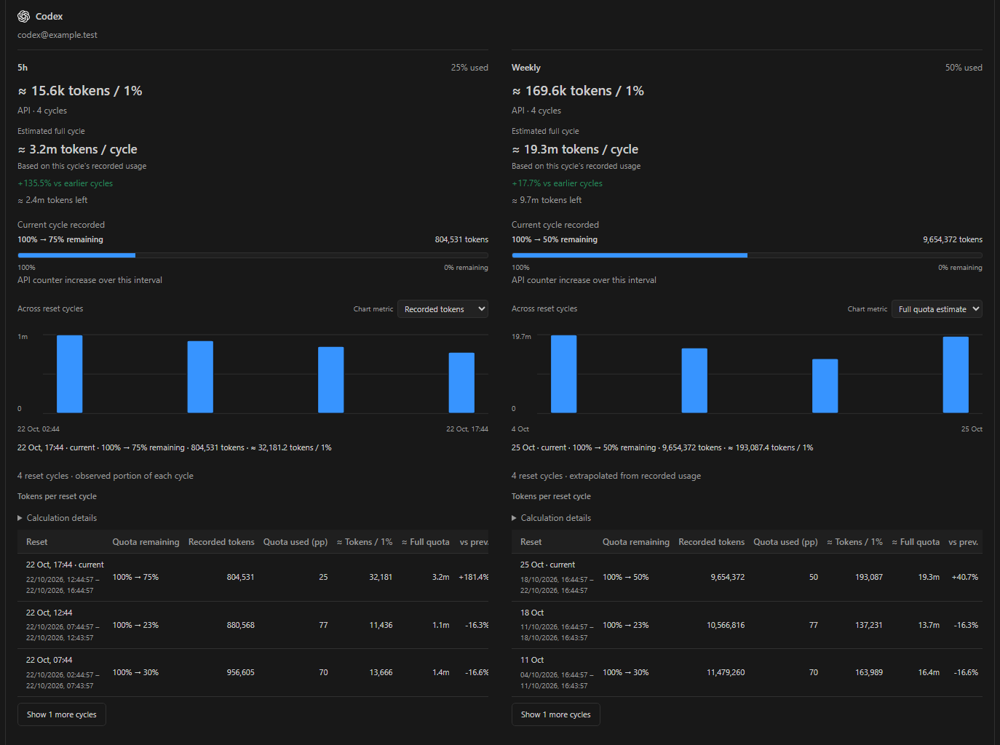

API, Local and Device estimates stay separate. A full-cycle estimate is an extrapolation, not a fixed token allowance. Model mix, cache usage, usage on other devices and incomplete local history can change the ratio. Local recorded counts may cover only part of the account's usage.

### Conversations and breakdowns

Search **Conversations** by title or project and select a row for its tokens, input/cache, output, API cost, quota-window equivalents, per-model split and daily totals. **Assign this conversation** opens history assignment for it.

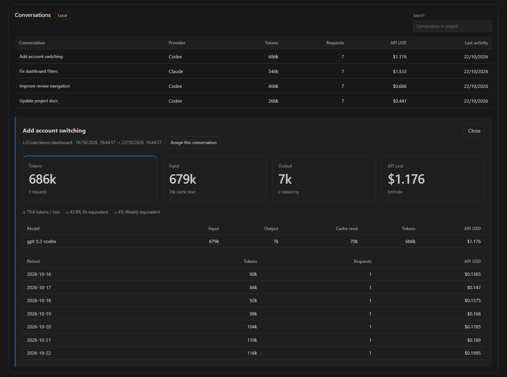

**Daily breakdown by model** groups usage by the selected period with a model-mix bar; expand a period to see each model. **Usage by account** totals Local tokens per account and shows how each row was attributed.

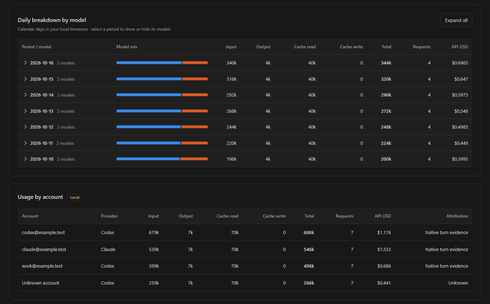

Refreshing reads quota and usage without sending an inference prompt. An open dashboard refreshes every minute and reuses a token-only history cache.

## Chat, history and checkpoints

Select **+**, choose **Codex** or **Claude Code**, then choose a model and access mode. Models come from the selected installed CLI. Reasoning effort appears where supported; Codex also offers a per-project **Fast mode** toggle.

- Stream replies and tool activity, respond to approvals and stop an active turn from the panel.
- Paste images, drag files into the composer or use the paperclip. Preview and remove attachments before sending; attachment-only messages are supported.
- Queue follow-ups while the agent works. Edit, delete, pause or resume the queue; saved queues require Resume after reloading.
- Open **History** to search and resume project conversations from either provider. **Edit and resend** branches an earlier message while preserving the original conversation and current files.
- **Restore code** previews a checkpoint saved before a turn started in AgentTandem. **Undo restore** recovers the code from before the latest restore. External CLI messages and older history may have no checkpoint.

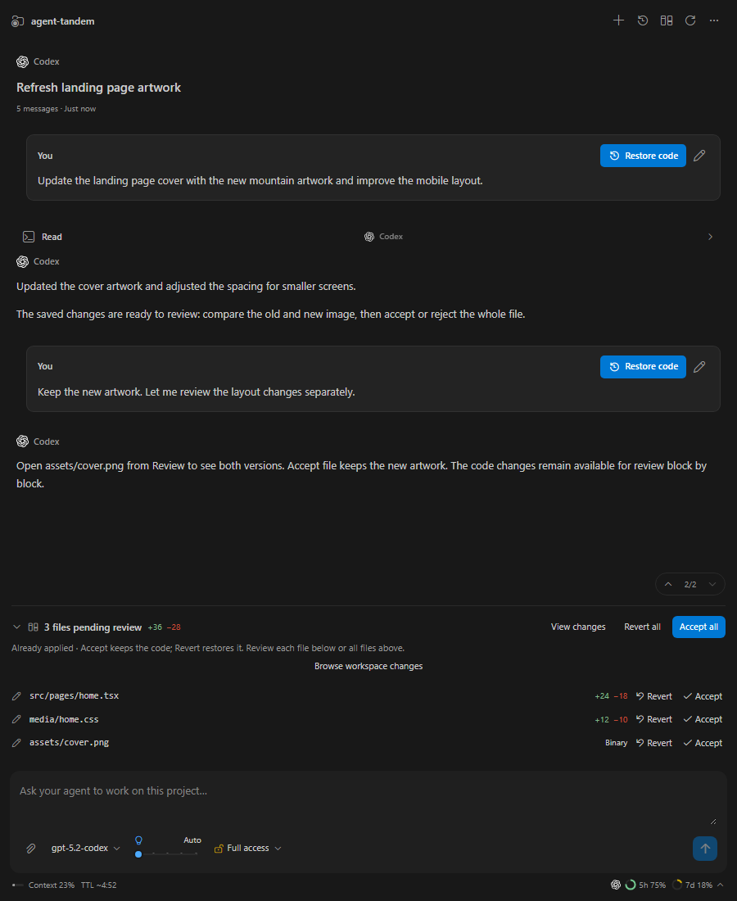

Project history and review shortcuts

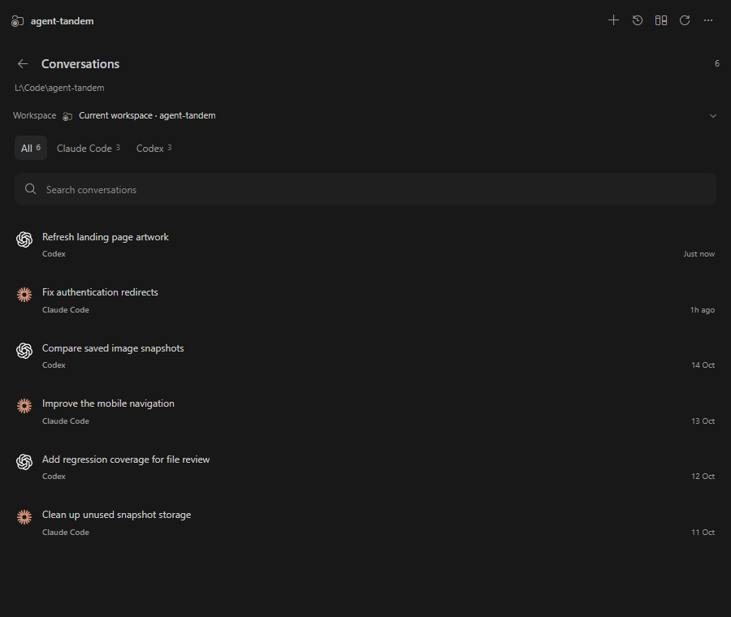

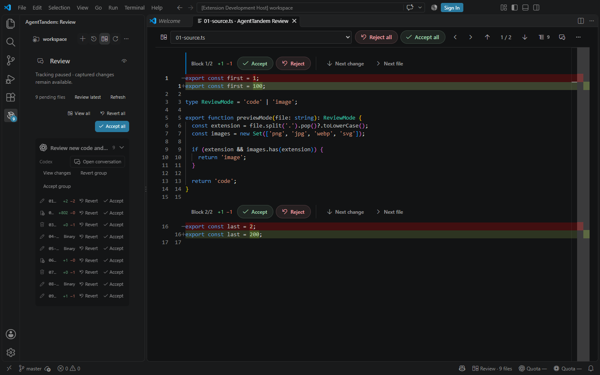

## Status bar and preferences

Open **Settings → Preferences** to show both agents, the selected chat agent, Codex only or Claude Code only. Choose compact icons with quota, progress bars, quota rings, minimal columns (one column per window plus the lowest percentage), icons only or full text; select quota windows, reset countdowns, banked resets, account/plan details and left/right placement. Codex and Claude Code each take their own text color: keep the quota status color, pick a theme color (follows your color theme) or a custom color; low quota still shows its warning colors. With remaining quota shown, each reset countdown sits right after its window behind a clock icon (`5h 75% 🕑2h14m · 7d 40% 🕑3d4h`; minimal shows only the tightest window's reset); the full-text style keeps `5h reset 2h 14m`. Hover retains full details in every style. `↻ 3` means three banked resets.

Status bar preferences

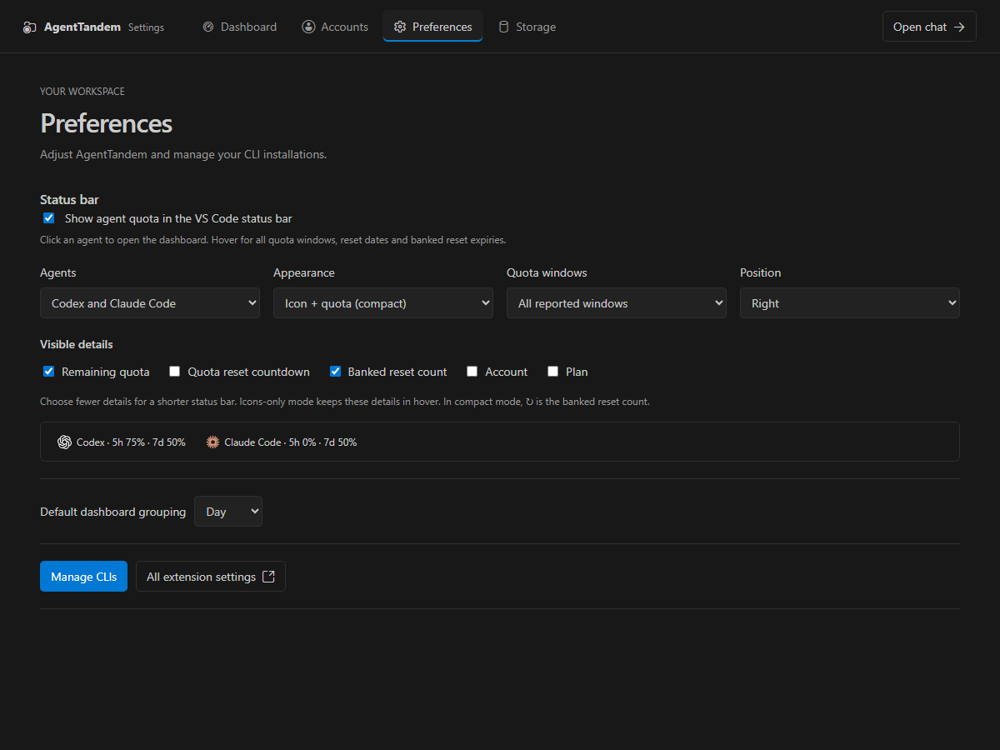

## Storage and restore history

Open **Settings → Storage** to see what agent history takes up and how much cleanup has reclaimed.

The status-bar hover also shows **Extension storage**, its measured size and the largest data categories. **Manage storage** opens the extension's **Unused files** tab directly, where you can inspect categories, choose what to clean and preview the exact files. AgentTandem checks its own data folder in the background every five minutes and refreshes after cleanup. Native Codex/Claude transcripts are managed separately in **Conversations**.

At **1 GB** by default, the hover and Storage page show a warning and a notification offers **Manage storage**. Notifications appear at most once per day. Change **AgentTandem: Storage Warning MB** (`agentTandem.storageWarningMB`) in VS Code Settings; set it to `0` to disable size warnings. Monitoring does not delete anything.

Two headline cards stay visible on every Storage tab:

- **In use now** totals Codex chats, Claude Code chats and AgentTandem data, with a bar showing the share of each.
- **Freed so far** keeps a running total of space reclaimed by deleting conversations, restore history and unused files. It also counts the conversations, files and cleanup runs, shows the size and time of the last cleanup, and survives VS Code restarts. Only data a run actually removed is counted.

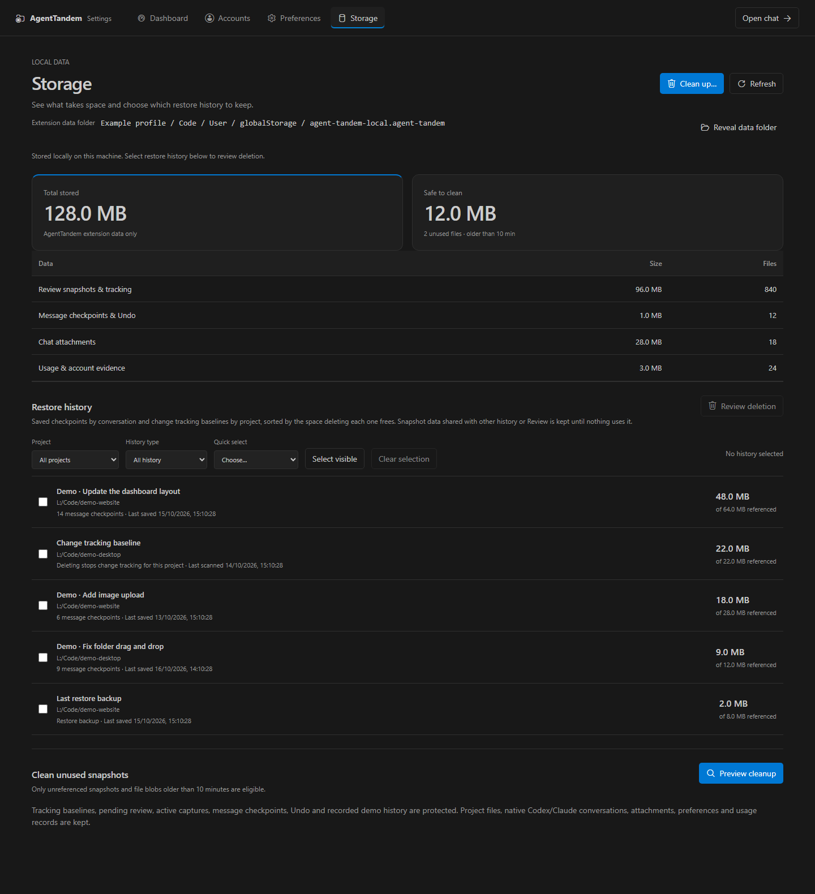

The **Restore history** and **Unused files** tabs inspect the extension data folder and storage categories. Filter saved restore history by project/type, select entries and **Review deletion** before removing them.

**Review snapshots & tracking** has two shortcuts, also available in the status-bar hover: **Clean accepted** previews unreferenced review snapshots left after Accept or other review actions, while keeping tracking baselines, checkpoints and Undo. **Clean all** also removes every message checkpoint and restore backup and stops change tracking across projects. Pending review and its revert Undo remain protected, so some space can remain. Both actions show the exact files and bytes before the final cleanup button. Captures less than 10 minutes old stay protected unless their saved history is explicitly removed. Workspace files, chats and recorded demos are kept.

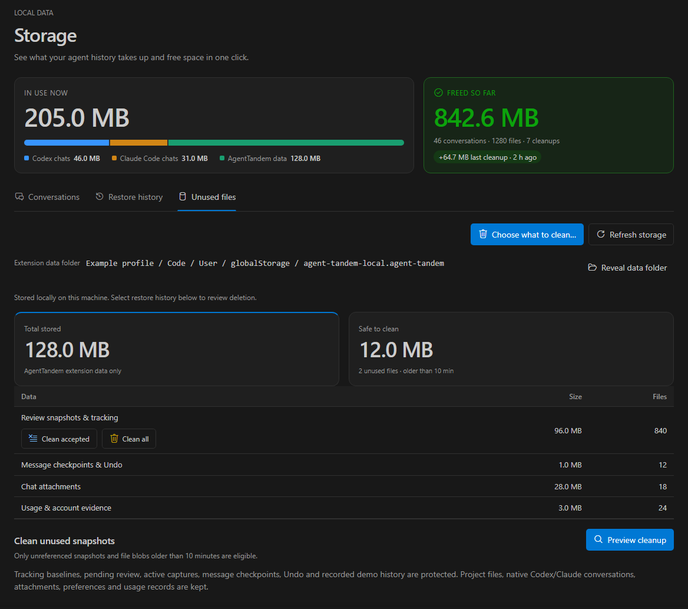

**Preview cleanup** lists unused snapshots and blobs older than 10 minutes. **Clean up…** lets you choose what to clean — message checkpoints, restore backups and/or unused snapshots — previews exactly those, then deletes them from the same preview. Cleanup rechecks references before deleting; tracking baselines, pending review, active captures, retained checkpoints and Undo remain protected. Workspace files and native Codex/Claude conversation history stay intact. Deleting selected restore history removes the ability to restore those checkpoints.

Storage lists the projects whose saved Review comparisons and revert Undo still hold snapshot data, even when unused snapshots show 0 B. **Clear saved review data…** previews clearing those comparisons, Undo, checkpoints and tracking, including the affected projects and exact snapshot files. Confirming permanently removes those restore abilities while keeping workspace files and chat messages. Active captures block clearing; changed metadata requires a new preview, and newly referenced files stay protected.

**Storage → Conversations** scans native chat transcripts across all projects in the displayed history folders (`CODEX_HOME` / `CLAUDE_CONFIG_DIR` when configured). **Last message** shows the latest user/assistant message time, including subagent files for Claude; click its heading to toggle oldest/newest first. Oldest first is the default. A `~` marks file update time used when a message timestamp is unavailable. Choose 7/30/90+ days or **Before date** (exclusive, at local midnight), and/or a **Year** (local calendar year of the last message, listed with counts), then optionally filter by provider, archive status or search. **Delete all matching (N)** applies the filters on the host and permanently deletes every match in one run, including rows beyond **Show more**; it first reads any message dates still loading (`N+` while they load). **Delete selected** immediately deletes only your selection. There is no extra confirmation step; a dialog follows the run and lists what was deleted and what was kept, with reasons. Deletion rechecks files and includes subagent payloads; a conversation with protected or newer-than-cutoff subagent history is kept instead of failing the whole run. Open conversations, queued messages and sessions updated within 10 minutes stay protected. Close other apps/terminals using these histories first. Codex archives are included; Claude Code has no native archive flag.

Native deletion is permanent and prevents resuming those conversations; token totals derived from deleted transcripts can decrease. Restore checkpoints are managed separately. Codex uses its native `thread/delete` API and requires a CLI that supports it. Early Codex rollouts (before `session_meta`, around September 2025) cannot be read by current Codex CLIs and are not in its thread index, so `thread/delete` rejects them as empty; AgentTandem deletes those files directly, only while Codex has no index entry for them, after the same file and protection checks; Claude uses the bundled SDK's `deleteSession`. Codex `.jsonl` and Zstandard `.jsonl.zst` transcripts are supported; compressed history is streamed in memory without unpacking it to disk. Reading Zstandard requires a VS Code extension host with Node 22.15 or newer. Errors and skipped entries remain visible. Linked, corrupt or unsupported transcript stores block deletion. No cleanup runs automatically. Developer validation: `npm run test:conversations:cleanup:live` uses an isolated native home without copying real history or credentials; append `-- --compressed` to test native deletion of compressed history.

Cleanup result

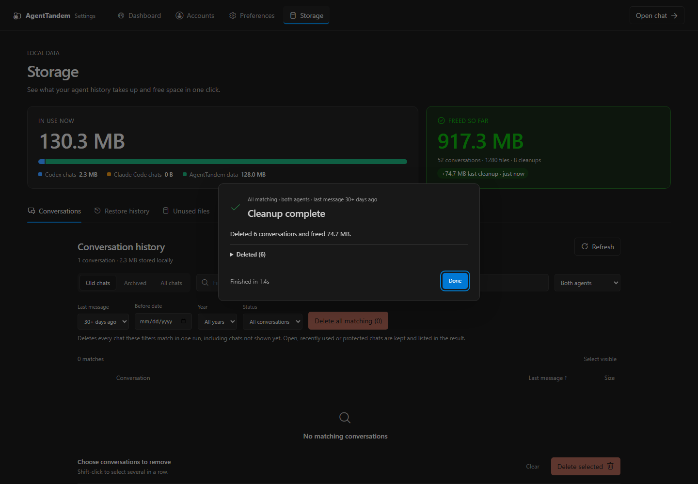

## WSL and remote workspaces

Install AgentTandem in the **WSL/SSH workspace** so it can access that environment's files and signed-in CLIs. After switching from a local development VSIX to the Marketplace extension, uninstall `agent-tandem-local.agent-tandem` in that environment and run **Developer: Reload Window**. Keep one AgentTandem extension enabled: both builds share commands and views. Uninstalling the extension keeps its saved data.

## Keyboard shortcuts

| Shortcut | Action |
| --- | --- |
| `Enter` / `Shift+Enter` | Send a chat message or queue a follow-up / insert a newline |
| `Alt+Y` / `Alt+N` | Accept / reject the current change in an active review editor |
| `Alt+Up` / `Alt+Down` | Previous / next change |
| `Alt+PageUp` / `Alt+PageDown` | Previous / next changed file |

*Screenshots capture the current interface with demonstration data. Account names, emails, token counts, quota values and switch logs are fictional.*

See [Contributing](CONTRIBUTING.md), [Development](docs/DEVELOPMENT.md) and [Release notes](CHANGELOG.md).

AgentTandem is an independent companion, not affiliated with OpenAI or Anthropic.
