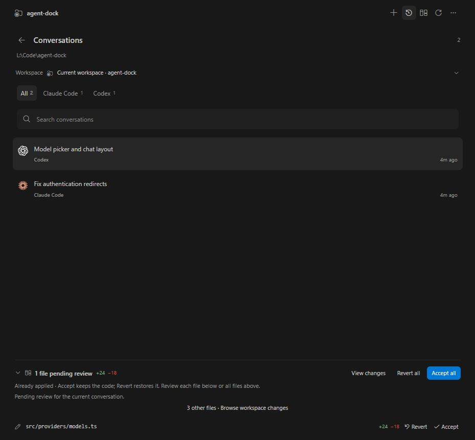
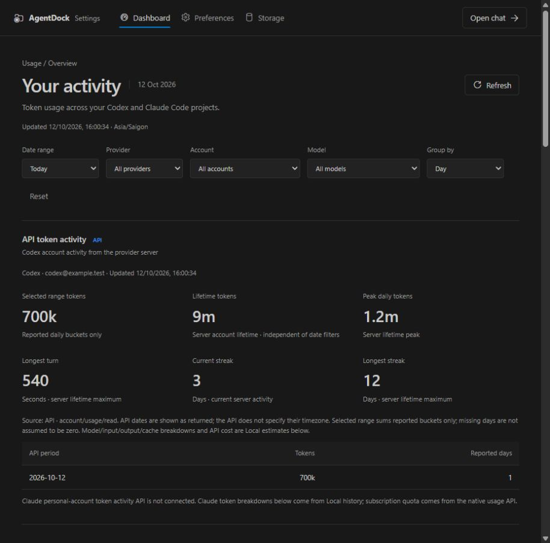
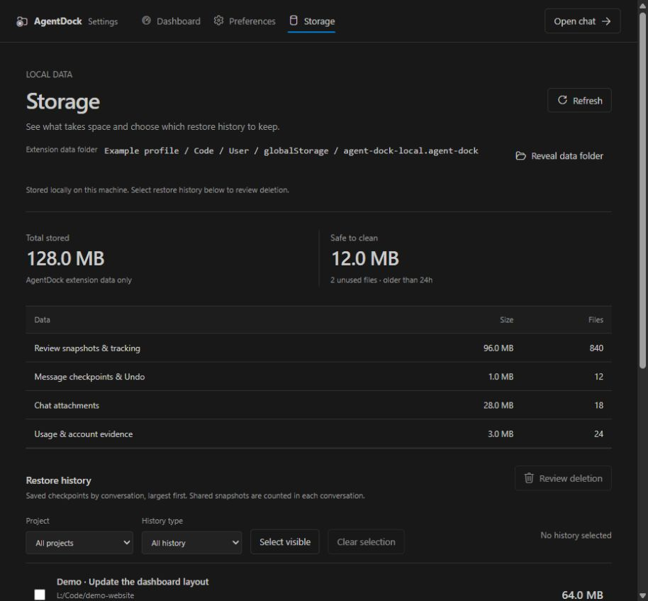

<p align="center"></p>

<h1 align="center">AgentDock</h1>
<p align="center"><strong>Your agents. Your workflow. A better view of the work.</strong></p>
<p align="center">A VS Code companion for Claude Code and Codex.<br>Review changes, return to checkpoints, pick up conversations, and see where your allowance goes.</p>

---

## Keep your workflow. Add a review layer.

Use Claude Code or Codex in their own tools, or chat directly in AgentDock. Saved workspace changes appear in one review panel, grouped by conversation when the source can be verified. Open a native diff, keep what works, and restore what needs another pass.

AgentDock opens to **Review**. Chat, history and usage are always close by.


*Product preview with demonstration data, rendered from AgentDock's actual interface.*

## What you get

| Feature | What it adds to your day |
| --- | --- |
| **Review across agents** | See saved changes from AgentDock, native CLIs and other editors in one place. Verified conversation groups keep context nearby; mixed and unknown sources stay visible as Shared and Unassigned. |
| **Native diffs, precise decisions** | Review a file or an individual change block. Accept keeps applied code; Revert restores its saved baseline. Previous/Next follows changes across files. |
| **Checkpoints and Undo** | AgentDock captures a checkpoint before its own chat turns. Preview a restore, return the code to that point, or undo the latest restore. |
| **One conversation workspace** | Find project conversations from Codex and Claude, resume a native session, or open chat in a sidebar or editor tab. |
| **Chat that fits real work** | Stream replies and tool activity, attach images or files, choose a model and reasoning effort, and answer approvals in the panel. |
| **A queue for your next steps** | Queue follow-up messages while an agent works. Edit, remove, pause or resume them. Pending messages survive a reload and wait for you to resume. |
| **Branch a conversation** | Edit and resend an earlier message into a new branch while keeping the original conversation in history. |
| **Usage with context** | See account/quota information, token history, cache usage and API-cost estimates. API, Local and Estimate labels explain where values come from. |
| **Local CLI management** | Discover and select native CLI installations, set project preferences and inspect provider diagnostics. |
| **Storage you can inspect** | Check snapshot usage and preview cleanup or restore-history deletion before applying it. |

## Chat with the tools you already use


*Product preview with demonstration data.*

Choose **Codex** or **Claude Code**, pick an available model, and send a message. AgentDock uses your local, authenticated CLI and its permissions. Images can be pasted, dropped or attached; provider support determines how other files are sent.

The composer keeps model, reasoning and access controls together. Tool output stays in the conversation, pending changes stay reviewable, and scrolling up while a reply streams keeps your reading position.

### Models, permissions and attachments

- Switch between Codex and Claude Code and select models exposed by your local CLI. Adjust reasoning effort and use Codex Fast mode on supported models/accounts.
- Choose an access mode and answer tool approvals in the panel. Provider-supported remembered permissions disclose their scope before you apply them.
- Paste or drag images into the composer, or use the attachment picker. Preview and remove attachments before sending. PDFs and other file types follow each provider's capabilities.
- Stop an active turn, keep drafts separate for each conversation, or queue your next instructions. Queued messages can be edited, removed, paused and resumed; they remain paused after a reload until you resume them.

## Pick up any project conversation



Find conversations by workspace, provider or search text. AgentDock reads native Codex and Claude history, refreshes as sessions change, and remembers your selection. Open a conversation in the sidebar or reuse an editor tab when you want more room.

**Edit and resend** branches an earlier message while preserving the original conversation. **Restore** previews a checkpoint recorded before an AgentDock turn. Code restore and conversation branching are separate actions, so you can decide which context and which files to keep.

## Understand usage, accounts and quota



The dashboard separates three kinds of evidence:

| Label | What it means |
| --- | --- |
| **API** | Activity or current quota returned by the provider when supported. |
| **Local** | Token records observed on this machine, broken down by account, provider, model and date. |
| **Estimate** | API equivalent cost or observed token-to-quota trends; these are not subscription billing statements. |

Filter by date range, account, provider and model; group daily, weekly or monthly activity. Inspect input/output tokens, cache reads/writes, reasoning tokens when reported, account limits and reset times. The composer shows context usage and cache TTL, and the optional status-bar quota indicator opens the dashboard directly.

## Keep restore history under control



Inspect local storage by category and conversation. Filter restore history by project and type, select the history you no longer need, then review its deletion preview. Snapshot cleanup targets unreferenced data older than 24 hours and protects pending review, active captures, checkpoints and Undo.

**Manage CLIs** keeps installations separate from the project: choose enabled native executables, set provider defaults or project overrides, scan for installations, and inspect diagnostics. The Getting Started walkthrough links tracking, review, CLI setup and usage in one place.

*All screenshots use demonstration conversations, accounts and usage values rendered by the actual AgentDock interface.*

## Get started

1. Install AgentDock in VS Code **1.100 or newer** and open a local project folder.
2. Install and sign in to [Claude Code](https://code.claude.com/docs/en/overview) or [Codex CLI](https://developers.openai.com/codex/cli).
3. Open **AgentDock: Manage CLIs** from the Command Palette and select your installation.
4. Open AgentDock in the Activity Bar. Review saved changes, open **History**, or select **+** to start a chat.

Use **AgentDock: Getting Started** for the in-editor walkthrough. **AgentDock: Open Settings and Usage Dashboard** opens usage, account information and preferences.

To install a downloaded package, use **Extensions → … → Install from VSIX…**, then select the `.vsix` file.

## A review loop that stays close to your code

1. **Work.** Continue in your native agent, or send a turn through AgentDock.
2. **Inspect.** Open a changed file in VS Code's inline diff. Review one block, one file or the entire group.
3. **Decide.** Accept keeps the current code and marks it reviewed. Revert previews file/group scope and checks for newer edits before restoring snapshots.
4. **Continue.** Keep the context, branch an earlier message, or restore an AgentDock checkpoint for another attempt.

| Shortcut | Action |
| --- | --- |
| `Alt+↓` / `Alt+↑` | Next / previous change in an AgentDock diff |
| `Alt+Y` | Accept the change block under the cursor |
| `Alt+N` | Revert the change block under the cursor |
| `Enter` / `Shift+Enter` | Send a chat message / add a newline |

The Marketplace build uses **CodeLens** for block actions, editor-title navigation buttons and the status-bar file picker. The local development build can also enable experimental floating controls.

## Know what is captured

- Review tracks **saved files in the open project**. Ignored files are excluded. Unsaved buffers and newer edits are checked before a restore or revert.
- A checkpoint belongs to a turn started in **AgentDock**. Older native transcripts do not acquire historical snapshots just by appearing in History.
- **Accept** marks already-applied code as reviewed; it does not create a Git commit. **Edit and resend** branches conversation context and keeps the current code.
- Native history discovery reads local provider records. Snapshot, queue and preference data are stored locally. Prompts and attachments sent through chat are handled by the selected provider through its CLI.
- Account, quota, Fast mode, models and attachment support depend on the selected provider, CLI version and account. API-cost estimates are separate from subscription quota.
- Agent execution requires a **trusted local workspace**. Virtual workspaces have limited support. AgentDock selects inline diff layout for review, which also affects the workspace's other diff editors.

AgentDock is an independent companion. It is not affiliated with OpenAI or Anthropic. Provider names and marks identify the tools it connects to.

## Build and release

```powershell
npm ci
npm run typecheck
npm test -- --maxWorkers=2 --testTimeout=15000
npm run package:marketplace -- --publisher coolbirdv --repository-url https://github.com/YOUR_ACCOUNT/YOUR_REPO
```

The package and SHA-256 checksum are written to `artifacts/`. **Build Marketplace VSIX** in GitHub Actions runs the checks, tests the stable build in a separate VS Code profile, and uploads a downloadable artifact. Enter your Publisher ID when running it manually, or set the `MARKETPLACE_PUBLISHER` repository variable for version tags.

The pipeline builds the file for you to upload manually. It does not require a Marketplace token.

- [Publisher setup and VSIX submission guide](docs/PUBLISHING.md)
- [Development, advanced behavior and verification](docs/DEVELOPMENT.md)
- [Release notes](CHANGELOG.md)

For local development with experimental controls, use `npm run dev` to build and install into your existing VS Code, or `npm run build` and launch the Development Host with **F5**.
