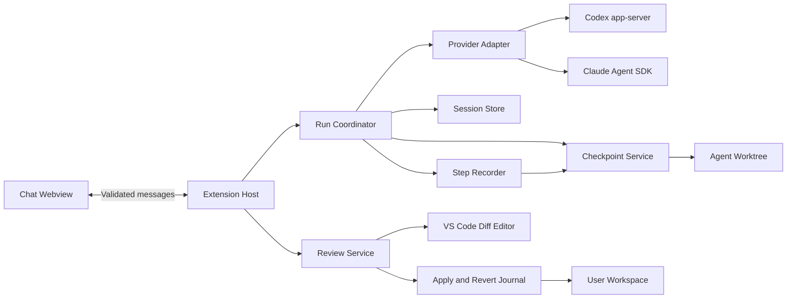

# Proposed AgentDock architecture

This is the MVP design described in the [implementation plan](PLAN.md). AgentDock owns the UI, session history, checkpoints and code transactions; providers own the agent loop. Specific APIs and configuration will be pinned after the integration spike.

## Main layers

The host registers one `WebviewViewProvider` for `agentDock.panel`, containing sessions, messages, previews and diagnostics. Inline diffs use stored snapshots and line patches. `openStep/openFile/openCumulative` commands update panel state only; `InEditor` suffixes and `openInTab` are opt-in editor actions. Two native tree views plus a default editor tab are no longer used.

Provider conversations are the primary input. `ProjectConversations` lists/reads local history, maps `(provider, sessionId)` and filters cwd by workspace root. The host polls revisions, retains selections and rejects stale asynchronous reads after project/session switches. Claude uses SDK session history; Codex currently uses a rollout compatibility reader. AgentDock owns only snapshots/journals and UI metadata; it never rewrites CLI transcripts to simulate synchronization. See [Conversation sync](CONVERSATION-SYNC.md).



The webview sends intents such as Send, Stop, OpenDiff, Apply or Revert. The host validates state, permissions and path scope before acting. The webview holds no secrets and cannot directly run shells or write files.

## Proposed source layout

```text
src/
  extension.ts
  host/                commands, views, host-webview bridge
  core/                models, run coordinator, state machines
  providers/
    codex/             app-server transport and event mapping
    claude/            Agent SDK integration and event mapping
    fake/              deterministic fixtures for UI and tests
  workspace/           worktree lifecycle, baseline, path policy
  checkpoints/         manifests, blobs, step recorder, recovery
  review/              diffs, merge, apply and reverse transactions
  storage/             sessions, events, migrations, journal
  security/            trust, permissions, secret redaction
webview/
  chat/
  sessions/
  review/
  shared/
tests/
  fixtures/
  unit/
  integration/
  extension/
docs/
```

This is a proposed layout, not a list of implemented directories. The MVP needs neither a monorepo nor a cloud backend.

## Provider contract

Adapters provide equivalent operations: capability discovery, session creation/resume, turn start, event streaming, approval answers, interrupt and process shutdown. Conversation branching is provider-dependent; UI code does not call provider-specific RPC names.

Capabilities include at least `streaming`, `resume`, `forkAtBoundary`, `interrupt`, `toolApprovals`, `modelDiscovery`, `usage` and `stepCapture` (`exact`, `grouped`, `unavailable`). Missing usage/model discovery is hidden rather than filled with invented metrics/models. Step capture depends on each run's hook/barrier state, not just provider identity.

Normalized events include session ready, turn started, text delta, tool started/output/completed, approval requested/resolved, provider warning, turn completed/interrupted/failed and transport disconnected. Every event carries `sessionId`, `turnId`, `runId`, `sequence` and native IDs where available.

AgentDock and provider IDs are stored separately. `runId` rejects stale process events after retry/reload; state machines ignore duplicates and never convert failed turns to success merely because the process exits with code 0.

### Codex

Use stdio with `codex app-server`. The adapter owns handshake, RPC correlation, event mapping and approvals. Generate schemas from the pinned CLI version. Provider diffs supplement activity; file snapshots drive review/revert.

Forking at a completed turn can use `thread/fork` with the last retained boundary. Reverting before the first turn creates a new thread. Avoid deprecated `thread/rollback`. Specific methods must pass contract tests against the version selected during the spike. [Codex App Server](https://learn.chatgpt.com/docs/app-server)

### Claude

Use the TypeScript Claude Agent SDK to control the Claude Code agent. Map session/message IDs and verify resume/fork against the pinned SDK. Terminal/ANSI parsing is not the primary data source. [Claude Agent SDK overview](https://code.claude.com/docs/en/agent-sdk/overview), [Claude sessions](https://code.claude.com/docs/en/agent-sdk/sessions)

Native file checkpoints are supplementary. AgentDock snapshots cover manifest files whether changed by tools or shells; native rewind does not replace general code restore. [Claude file checkpointing](https://code.claude.com/docs/en/agent-sdk/file-checkpointing)

## Stored data

| Entity | Main fields | Purpose |
| --- | --- | --- |
| Session | id, workspace identity, provider, providerSessionId, activeBranchId, worktreeId | Reopen the correct repository/provider |
| ConversationBranch | id, parent, forkBoundary, activeTurns, contextMode | Preserve history and branch conversations |
| Turn | id, runId, prompt, context refs, providerBoundary, status, before/afterCheckpointId | Connect requests, execution and code |
| Step | id, turnId, providerItemId/toolUseId, kind, status, snapshot refs, captureMode | Connect operations to verified code boundaries |
| Event | sequence, time, runId, kind, payload refs | Recover timelines and reconcile activity |
| Checkpoint | id, parent, manifest, completeness, scope policy | File boundaries independent of conversation state |
| FileVersion | path, kind, hash, bytes, encoding metadata | Restore text/binary and added/deleted files |
| ChangeSet | turnId, optional stepId/groupId, base, result, files, captureMode, decision per file | Step/group changes or whole-turn review |
| Transaction | id, operation, file before/after, preconditions, steps, status | Apply/revert and crash recovery |

Conversation branches and code checkpoint chains are separate because Conversation Only and Code Only intentionally create different states. Each new turn records actual code and active conversation boundaries.

Workspace identity uses canonical roots/repositories, not folder names alone. Resume checks repository/branch identity. Branch changes, moved repositories or missing worktrees require reconciliation.

## State machines

A run follows `preparing → running ↔ awaitingApproval → stopping → completed/interrupted/failed`; direct completion from running is also valid. Preparation failure never starts the provider. Stop is confirmed only after the process and related writers have stopped.

Review has separate states: `none`, `pending`, `partiallyResolved`, `resolved`, `conflicted`. Completed turns can still have pending reviews; UI must not collapse these into one generic success state.

New turns require resolved review and reconciled worktrees. Apply/revert locks active turns. Host locks use repository identity and must be checked by multiple VS Code windows sharing a repository.

## Preparing agent workspaces

Git supports multiple worktrees for one repository. Use a separate worktree per session, while recognizing that shared Git metadata means it is not a security sandbox. [Git worktree](https://git-scm.com/docs/git-worktree)

Proposed baseline workflow:

1. Verify a committed repository, current root and no unfinished apply/revert transaction.
2. Detect unsaved buffers in scope. Request saving before baseline; cancel if declined rather than dropping buffers or silently using stale disk data.
3. Build a manifest from allowed tracked/untracked files, disclosing exclusions, limits and unsupported files.
4. Create a worktree from the captured revision. Overlay current disk edits/additions/deletions. Use temporary-index Git plumbing if needed without staging/stashing the main workspace.
5. Recheck hashes/revision for changes during copying; rebuild the baseline or cancel if inconsistent.
6. Save the initial checkpoint before sending the prompt and worktree cwd to the provider.

Do not copy `.git`, secrets, ignored build output or dependencies by default. Dependency setup needs an explicit policy: install in the worktree or copy selected scope, without writable links into the main workspace. Do not promise immediately working builds when local dependencies remain unprepared.

The MVP rejects unsupported symlinks, hardlinks/reparse points, submodules and uninvestigated nested repositories. Validate canonical targets and parents, including Windows junctions; string prefixes alone are insufficient.

## Snapshots and diffs

Snapshots store bytes by content hash and manifests mapping path → version. Scope is explicit. Excluded/over-quota files mark checkpoints incomplete; incomplete manifests cannot be offered as full restores.

Capture final snapshots after agents and all possible file-writing processes stop. Watchers support UI updates; final file rescans confirm state. Background writers keep the UI unstable and block apply/revert.

Diff initial/final checkpoints, including new untracked files. MVP renames may appear as delete + add. Binary files use hash/size and suitable previews instead of text diffs. Restore preserves bytes, CRLF, BOM and encoding.

Manifest source/configuration files are restorable; ignored build output, processes, network/database activity and other external side effects are outside code undo. Show relevant limits in the actual operation's preview.

Open text diffs through `vscode.diff` with read-only snapshot URIs containing session/checkpoint/file IDs. The host rejects arbitrary webview paths. View All can use `vscode.changes`, with minimum-version verification and file-list/single-diff fallback. [VS Code built-in commands](https://code.visualstudio.com/api/references/commands)

### Per-step snapshots and diffs

Step Recorder captures before/after writes through verified barriers/hooks, serializes writers where possible and groups overlapping operations. Provider notifications/watchers support timelines; they do not guarantee files are stable. See [VS Code research](VSCODE-API-RESEARCH.md) for APIs, provenance and limits.

Store each step's ChangeSet and cumulative boundaries from turn start. Content providers read immutable blobs; old-step diffs must not use changing worktree files for either side. Any live preview uses a separate URI and is clearly marked unfixed.

Step viewing is read-only and allowed while running. Apply/Discard/Revert use the post-turn engine. Tool-internal boundaries do not automatically become conversation restore boundaries; conversation revert remains turn-based.

## Applying code to the main workspace

Three versions participate: initial `base`, final `agentResult`, and `userCurrent` immediately before apply. Use three-way merging to apply agent deltas to current user code.

- If `userCurrent == base`, apply the agent result after path/buffer checks.
- If both changed, merge provably nonoverlapping regions; otherwise mark the file conflicted for review.
- New-name collisions, user-edited deletions and concurrently changed binary files are conflicts.
- Unsaved target buffers block transactions until saved/cancelled; never write disk beneath a different buffer.

Apply All prepares/checks every file before writing; any unresolved conflict blocks the full transaction. Apply File handles selected files separately. Opening a diff never grants a write action.

Journal before/after bytes and expected hashes. Recheck before each step, use temporary files where possible, verify results and then mark committed. Preserve the index; never Git reset/clean or automatically commit the main workspace.

Multi-file writes are not collectively atomic. Mid-write errors/crashes retain partial journal state for hash-checked rollback/recovery. Later user edits produce conflicts rather than being overwritten during rollback.

After apply/discard, reconcile the worktree to the decided code. Use context updates or rebuilt sessions if the provider cannot reliably receive changes. The next baseline uses reconciled code, not an assumed unchanged agent result.

## Reverting code and conversations

Prepare a plan containing conversation boundary, code checkpoint, applied transactions to reverse and affected files. Capture current state for recovery before changing anything.

For applied code, reverse transactions after the boundary in reverse order, detecting/merging independent edits against current user code. Do not overwrite the main workspace with an entire old snapshot. Discarded files create no reverse transaction there.

For conversations, prepare a verified native fork. Otherwise create a new session with retained messages and current code-state descriptions, without fabricating tool results or claiming exact reconstruction of hidden provider context.

Conversation and Code switches active branch only after code restore completes. Fork/restore failure retains the original boundary, journals recovery and never presents a partial revert as complete.

Old branches remain readable. Restoring them needs the same code/conflict checks; browsing history never automatically reapplies files.

## Storage and recovery

Store session metadata, events, checkpoints and worktrees in extension-managed storage outside source repositories. Use schema versions, temporary-write/rename metadata and append-only file-transaction journals.

On activation, migrate schemas, reconcile transactions, inspect live locks/processes and restore sessions/reviews. Never automatically replay prompts, apply changes or delete unreviewed worktrees.

Retention uses configurable quotas and blob reference counts. Never delete checkpoints referenced by sessions/branches/revert journals. Insufficient space stops turns before promising complete checkpoints and offers cleanup of resolved data.

Worktree cleanup validates AgentDock ownership metadata and paths inside managed storage. General cleanup must never delete user repositories.

## Permissions and execution boundaries

Untrusted workspaces permit history/setup only, without spawning agents/shells or writing code. VS Code exposes Workspace Trust APIs and manifest capabilities. [Workspace Trust Extension Guide](https://code.visualstudio.com/api/extension-guides/workspace-trust)

Extension-managed secrets use SecretStorage; tokens/keys never enter webviews, transcripts or logs. Do not read another app's token files to invent authentication. Runtime uses supported API/CLI authentication verified in the spike.

Provider permissions/sandboxes constrain cwd/write scope; approvals are handled in the host. If runtime cannot block writes outside the worktree, do not advertise safe isolation: limit tools or leave writes disabled for that configuration. The MVP forbids agent index/ref/worktree metadata operations, including through shells.

Webviews use CSP, script nonces, limited resource roots, sanitized Markdown and schema validation. Spawn executables with argument arrays rather than concatenating prompts/paths into shell commands. Theme and keyboard accessibility follow VS Code webview UX. [VS Code webview UX](https://code.visualstudio.com/api/ux-guidelines/webviews)

## Required evidence before full implementation

1. Adapters work on Windows with Extension Host runtime and supported authentication.
2. Stop leaves no background writer modifying worktrees after checkpoints.
3. Fork/fallback genuinely removes later conversation context from new turns.
4. Dirty baselines preserve user index/branch/files.
5. Apply/reverse preserves user edits and recovers partial transactions.
6. Dependencies and excluded files are disclosed before execution.
7. Immutable step snapshots reopen correctly even when several steps edit one file; concurrent changes are not attributed to the wrong step.

Any unproven point requires contract/scope changes in [PLAN.md](PLAN.md) before the UI presents it as supported.
